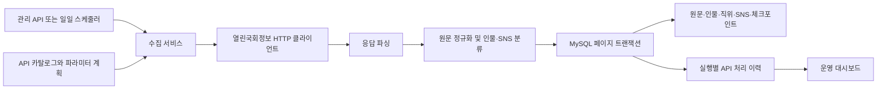

# Parliament 코드 파악

분석 기준: 2026-10-03, `main`, 커밋 `8dbd57458fedb7cd7898e2db825d557f81234ede`.

## 서비스의 역할

열린국회정보 API에서 원문을 수집하고 인물·직위·SNS를 MySQL에 정규화하는 로컬 데이터 플랫폼이다. 적재 운영 대시보드는 있지만, 일반 사용자가 정부 활동을 검색하거나 분석하는 서비스 API는 아직 없다. AWS 인프라, SQS/SNS 연계, 배포 파이프라인도 현재 코드에서 확인되지 않았다.

Java 17, Spring Boot 3.3.5, WebFlux/Reactor, R2DBC MySQL, Gradle 8.2를 사용한다. MySQL 8.4는 Docker Compose로 실행하고 로컬 3307 포트를 사용한다. 화면은 정적 HTML/CSS/JavaScript다.

## 데이터 흐름

1. 카탈로그 272개 중 DATA 269개가 대상이고 VIDEO 3개는 제외된다. 이는 저장소 스냅샷 기준이며 현재 외부 API의 동작 여부를 검증한 수치는 아니다.
2. 추가 파라미터 계획 82개는 PARAMETERIZED 72개, EMPTY_ALLOWED 7개, RETRYABLE 3개다. 파라미터는 현재 국회 대수·날짜 등 정적 값이나 먼저 적재한 원문의 식별자에서 얻는다.
3. `/preflight`는 소스별 샘플 한 페이지를 읽어 정규화 가능 여부를 확인하며 적재하지 않는다. 동적 파라미터 샘플 해석에는 기존 DB 조회가 필요할 수 있다.
4. `/run`은 소스와 파라미터 조합별 체크포인트에서 이어서 적재한다. 한 페이지의 데이터와 체크포인트를 같은 트랜잭션에 저장한다.
5. `/sync`는 API 페이지를 읽고 원문 해시를 비교한다. 동일한 행은 관찰 시각만 갱신하고 새 행과 변경 행만 재적재한다. 부모 식별자 기반 소스는 마지막 성공 워터마크 이후 바뀐 식별자로 범위를 좁힌다.
6. 최신 의원 명부와 공식 SNS 명부는 완전 수집이 끝났을 때 사라진 원문을 정리한다. 최신 의원 명부 처리 후 현역·전직 분류를 다시 계산한다.
7. 실행 및 소스별 결과는 영구 이력 테이블에 남는다. 대시보드는 일별 최신 상태와 개별 실행 이력을 표시한다.

## 주요 코드 지도

| 경로 | 책임 |
|---|---|
| `controller/ParliamentIngestionController.java` | 관리 키 인증, preflight/run/sync/SNS 검증 엔드포인트 |
| `service/ParliamentIngestionService.java` | 페이지 적재, 재개, 증분 갱신, 실행 결과 집계 |
| `service/ParliamentParameterResolver.java` | 정적 파라미터 및 부모 원문의 식별자 조합 해석 |
| `api/WebClientParliamentApiClient.java` | 허용된 국회 HTTPS 호스트 호출, 타임아웃·재시도·응답 크기 제한 |
| `domain/ParliamentRecordNormalizer.java` | 원문 JSON·해시·레코드 키 생성, 구조화 필드에서 인물 추출 |
| `domain/ParliamentPersonClassifier.java` | 국회의원·공직자·기타 인물 분류와 신원 키 생성 |
| `persistence/R2dbcParliamentStagingRepository.java` | SQL, 페이지 트랜잭션, 체크포인트, 스냅샷 정리, 실행 이력 |
| `service/ParliamentSocialVerificationService.java` | SNS URL 허용목록·리다이렉트·도달 상태 확인 |
| `service/ParliamentDashboardService.java` | 날짜별 적재 상태 및 예정·누락 상태 계산 |
| `resources/sql/schema-parliament.sql` | 12개 테이블과 현역·전직 의원 뷰 |
| `resources/parliament/` | API 카탈로그와 파라미터 계획 |
| `resources/static/dashboard/` | 운영 화면 |

Java 경로의 공통 접두사는 `src/main/java/dev/parliament/`, resources는 `src/main/resources/`다.

## 데이터 해석상의 경계

- 의원 외부 ID가 있는 인물은 확정 식별자로 묶는다. 외부 ID가 없는 인물은 이름·직위·소속 기반 임시 후보이며 동일인 여부를 확정하지 않는다.
- 공직자 분류는 직함 키워드 규칙이다. 자유문에서 사람을 찾는 NER, 정부 활동 요약, SNS 게시물 수집, 영상 분석은 구현 범위에 포함되지 않는다.
- SNS 공식 명부 수록 여부와 URL 도달 여부는 별도 상태다. URL 도달은 계정 소유권이나 플랫폼 인증 배지를 증명하지 않는다.
- 상위 API에 변경 시각 필터가 없으면 증분 실행에서도 페이지 전체를 읽는다. 해시 비교는 DB 재쓰기를 줄이는 방식이다.
- 안정적인 레코드 ID가 없는 행은 내용 해시로 키를 만든다. 이런 행의 내용 변경은 기존 행의 수정으로 연결되지 않을 수 있다.

## 실행과 검증 상태

Java 17, Docker, 국회 API 키, 관리 키와 DB 환경 설정이 필요하다. 적재는 기본 비활성이고 `enabled`, `write-enabled`, 요청의 `confirmWrite`가 모두 켜져야 쓰기 작업이 실행된다. 자동 동기화도 기본 비활성이다. 초기 볼륨은 스키마를 자동 적용하지만 기존 DB에는 마이그레이션을 별도로 적용해야 한다.

`./gradlew test --offline`을 실행했으나 로컬에 Java 25만 설치되어 Gradle 8.2의 빌드 스크립트 분석 단계에서 `Unsupported class file major version 69`로 실패했다. 테스트 본문은 실행되지 않았고 통과 여부와 커버리지는 확인하지 못했다. DB 통합 테스트는 Docker MySQL 또는 외부 테스트 DB가 필요하다. 실제 국회 API 호출과 DB 적재는 수행하지 않았다.

## 확장 전에 살펴볼 지점

- 저장소 구현은 808줄이며 SQL·인물 저장·SNS 저장·실행 이력을 한 클래스가 담당한다. 기능 확장 시 책임별 분리가 유용하다.
- 작업 중복 방지 장치는 프로세스 내부 AtomicBoolean이다. 여러 인스턴스가 실행되면 공유 잠금이 필요하다.
- 수집 순서는 부모 의존 여부로만 정렬한다. 다단계 의존성이 추가될 경우 전체 의존 그래프에 따른 순서 처리가 필요하다.
- 일반 사용자용 서비스를 만들려면 현재 수집 DB 위에 조회 API, 검색·필터, 활동 단위 데이터 모델과 화면을 추가해야 한다.

`graphify-out/graph.json`과 `graph.html`은 탐색용 자동 추출 결과다. Java AST의 일반 타입·메서드 이름 노드가 포함되어 있으므로 연결만으로 실제 호출이나 설계 의도를 단정하지 말고 원문을 확인해야 한다.
