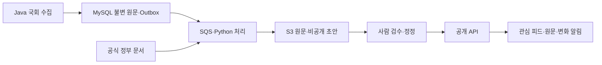

# GitHub에서 개발하기

처음 내려받았다면 `python3 scripts/bootstrap_repository.py`로 비공개 운영 입력 대신 안전한 예시 입력을 준비하세요. 기존 로컬 파일은 덮어쓰지 않습니다.

[코드 관리·CI 절차](docs/development/github-workflow.md) · [기여 안내](CONTRIBUTING.md) · [보안 안내](SECURITY.md)

실제 원고·뉴스 관측·검수 후보·운영 원장과 미디어는 로컬에 보존하며 이 소스 저장소에 포함하지 않습니다. 기존 실행 설명에 나오는 운영자 전용 문서는 새 clone에 포함되지 않습니다.


---

# 정부활동 추적 서비스

정치에 관심 있는 사람이 인물·법안·이슈의 변화를 근거와 함께 따라가는 서비스입니다. 기존 국회 수집기에 Java 공개 API, Python 공식 발표 처리, Next.js 모바일 웹을 연결했습니다. 원문과 설명은 버전으로 보존하고, 검수 전 초안은 공개하지 않습니다.

## 구현된 서비스

- 공개 활동 피드·인물·법안·표결·10개 이슈·검색·자료 범위, 발생일/공개일/수집일 구분.
- 표결회차별 모든 공개 의원 기록을 한 사건으로 묶기, 소스별 복합키와 대소문자 보존.
- 원문 버전과 outbox의 동일 트랜잭션 저장, 진행 중 법안의 하위 기록 재조회, 주간 전체 부모 대조.
- 이메일 1회 인증, 관심 목록, 주간/일간 묶음, 해지, 정정 이력과 이전 공개 버전.
- 정책브리핑·총리실·대통령 공식 페이지 처리, 이용 조건에 따른 공개 차단, 로컬/S3/SQS 어댑터.
- 선택적 근거 기반 AI 초안, 모든 소스가 공유하는 월간 비용 원장, 하루 최대 3개 설명 검수.
- 기본 비공개 메일 미리보기, 명시적 SES 발송, 불명확한 발송 결과의 자동 재전송 방지.
- 개인/기관 인터뷰 양식·가격 실험·기여이익·활성화/4주 재방문 측정, AWS 배포와 복원 도구.



첫 베타를 위한 코드와 운영 도구를 구현했으며, 실제 API 계약·전체 제22대 적재·사용자 조사·공개 배포는 별도 검증 대상입니다. [구현 상태](docs/IMPLEMENTATION_STATUS.md), [공개 API/검수 계약](src/main/resources/tracking/README.md), [Python 실행](worker/README.md), [웹 실행](web/README.md)을 확인하세요.

## 제품과 사업 실행 자료

[편집·정정 원칙](docs/product/editorial-policy.md), [사용자·기관 조사와 가격 실험](docs/business/research-and-pricing.md), [인터뷰 기록](docs/business/interviews.csv), [실험 기록](docs/business/experiments.csv), [출처 계약](docs/data/source-contracts.md), [인물 식별 재구축](docs/person-identity-rebuild.md), [AWS 운영](infra/aws/README.md)에 실제 수행 절차와 미검증 항목을 구분했습니다. 인터뷰 결과·결제·시장 수치를 임의로 만들지 않습니다.

## 현재 준비 범위

- 열린국회정보 공개 API 카탈로그 272개를 스냅샷으로 관리합니다.
- 일반 데이터 269개는 사전 점검 및 페이지 적재 대상입니다.
- 영상 관련 3개 API는 `VIDEO / EXCLUDED`로 고정해 호출과 적재에서 제외합니다.
- 모든 응답 행의 원문 JSON과 해시를 보존하고, 체크포인트로 중단 지점부터 재개합니다.
- 추가 파라미터 때문에 미수집이던 82개 API는 72개 파라미터형, 7개 정상 빈 결과형, 3개 재시도형으로 분류했습니다. 파라미터형은 현재 국회 대수 등 정적 값 53개와 선행 API 식별자 연계형 19개로 나뉩니다.
- 구조화된 인물 필드에서 국회의원, 정부 공직자, 기타 인물 후보를 분류합니다.
- 국회가 제공한 SNS 필드를 X, YouTube, 네이버 블로그, Facebook, Instagram, Threads, TikTok, Telegram의 정규 URL로 매핑합니다.
- SNS는 국회 공식 디렉터리 수록 여부와 현재 URL 도달 여부를 별도 상태로 보존합니다.
- 외부 키가 확인된 국회의원만 확정 식별자로 병합합니다. 이름만 있는 사람은 자동 병합하지 않고 `PROVISIONAL_NAME_MATCH`로 둡니다.

### 인물 분류 원칙

| 종류 | 판단 근거 | 식별 방식 |
|---|---|---|
| `LEGISLATOR` | 의원 이름과 유형이 확인된 외부 ID가 있음 | ID 네임스페이스와 정확한 값의 해시 |
| `PUBLIC_OFFICIAL` | 국무총리·장관·차관·청장 등 공직 직함이 명시됨 | 이름·직위·소속 기반 후보 키 + 직위 이력 |
| `OTHER` | 증인·참고인·전문가 등 위 두 근거가 없음 | 이름·직위·소속 기반 후보 키, 추후 검수 |

이름만 같은 사람을 동일 인물로 확정하지 않습니다. 자유문 본문에만 등장하는 인물의 NER(개체명 인식)와 영상 분석은 이번 단계의 범위가 아닙니다. 자유문 원문은 `parliament_source_record.raw_payload`에 남으므로 후속 분석기를 안전하게 붙일 수 있습니다.

## 안전장치

다음 세 조건이 모두 충족되어야 실제 DB 쓰기 요청이 동작합니다.

1. `PARLIAMENT_INGESTION_ENABLED=true`
2. `PARLIAMENT_INGESTION_WRITE_ENABLED=true`
3. `/run` 요청 본문의 `confirmWrite=true`

사전 점검(`/preflight`)은 외부 API 한 페이지만 읽고 DB에는 쓰지 않습니다. API 키와 관리 키는 환경변수로만 주입하며 저장소·응답·로그에 기록하지 않습니다. 국회 API 클라이언트는 `https://open.assembly.go.kr`만 허용합니다. 사내 HTTPS 검사 환경에서는 `PARLIAMENT_OPEN_ASSEMBLY_CA_CERTIFICATE`에 로컬 CA PEM 경로를 지정할 수 있으며, 파일 자체는 저장소에 넣지 않습니다.

## 로컬 준비

요구사항은 Java 17과 Docker입니다. 직접 웹/worker를 실행한다면 Node.js 24와 Python 3.11 이상, uv도 필요합니다. Spring Boot 3.5.16의 [공식 Java·Gradle 요구사항](https://docs.spring.io/spring-boot/3.5/system-requirements.html)에 맞춰 Gradle 8.14.3과 공식 배포 SHA256을 고정했습니다.

```bash
python3 scripts/local_env.py
# 새 .env에 로컬 전용 무작위 비밀번호·관리 키 생성. 기존 파일은 덮어쓰지 않음.
docker compose --profile app up -d --build
# 웹 http://localhost:3000 · API http://localhost:8080
```

직접 개발 서버를 실행할 경우:

```bash
set -a
source .env
set +a
docker compose up -d mysql
./gradlew bootRun
# 다른 터미널에서: cd web && npm ci && npm run dev
```

`.env`는 Git에서 제외되고 생성 시 권한은 0600입니다. MySQL은 로컬 `3307` 포트에 뜨며 최초 볼륨 생성 때 국회·추적·지표 스키마를 적용합니다. 시작 데이터는 비어 있습니다. 합성 정치 기록을 서비스 데이터로 넣지 않습니다. `TRACKING_PUBLIC_BASE_URL`과 웹 `PUBLIC_BASE_URL`은 같은 origin이어야 합니다. 실제 메일 제공자 설정 전에는 로그인 메일을 비공개 spool에서만 확인할 수 있습니다.

## 사전 점검만 실행

아래 요청은 DB 적재를 수행하지 않습니다.

```bash
curl -X POST http://localhost:8080/admin/ingestion/parliament/preflight \
  -H "Content-Type: application/json" \
  -H "X-Parliament-Ingestion-Key: $PARLIAMENT_INGESTION_ADMIN_KEY" \
  -d '{"sourceKeys":["allnamember","negnlnyvatsjwocar"],"pageSize":10,"maxPages":1,"confirmWrite":false}'
```

`sourceKeys`를 빈 배열로 보내면 영상 제외 후 활성화된 전체 카탈로그를 대상으로 합니다. 처음에는 의원 기본정보 `allnamember`와 SNS `negnlnyvatsjwocar`처럼 작은 묶음으로 확인하는 것을 권장합니다.

## 적재와 증분 동기화

최초 적재 또는 중단 지점 재개는 `/admin/ingestion/parliament/run`을 사용합니다. 페이지 단위 트랜잭션이 성공한 뒤에만 파라미터 조합별 체크포인트가 이동합니다.

이미 적재된 소스의 갱신은 `/admin/ingestion/parliament/sync`를 사용합니다. 동일 해시는 관찰 시각만 갱신하고, 변경 원문과 처리 작업은 페이지 체크포인트와 같은 트랜잭션에 저장합니다. 법안 심사·표결 하위 소스는 부모 변경 여부와 진행 중 상태를 함께 확인합니다. `/admin/ingestion/parliament/reconcile`은 워터마크와 관계없이 전체 부모를 대조합니다.

일부 국회 API는 `modified-since` 조건을 제공하지 않으므로 변경 여부를 확인하기 위한 페이지 읽기는 필요합니다. 이 경우에도 DB의 원문·정규화 재적재는 변경 행으로 제한됩니다. 최신 의원 명부와 공식 SNS 명부는 완전 스냅샷으로 취급해 사라진 원문을 정리하고, 현역/전직 분류도 같은 트랜잭션 흐름에서 다시 계산합니다.

자동 실행은 기본적으로 꺼져 있습니다. 실제 응답과 호출 제한을 확인한 소스만 명시합니다. 빈 목록으로 자동 실행하면 전체 카탈로그를 호출하지 않고 건너뜁니다. 일간 명부와 주간 대조는 별도 일정입니다.

```bash
PARLIAMENT_AUTOMATIC_SYNC_ENABLED=true
PARLIAMENT_INCREMENTAL_CRON='0 0 */6 * * *'
PARLIAMENT_INCREMENTAL_ZONE='Asia/Seoul'
PARLIAMENT_INCREMENTAL_SOURCE_KEYS=billrcp,billinfodetail,nojepdqqaweusdfbi,billjudgeconf,billlwjudgeconf
PARLIAMENT_DAILY_SOURCE_KEYS=allnamember
PARLIAMENT_RECONCILIATION_ENABLED=true
```

## 적재 모니터링 대시보드

애플리케이션 실행 후 `http://localhost:8080/dashboard`에서 일별·API별 적재 상태를 확인합니다. 화면에서 `PARLIAMENT_INGESTION_ADMIN_KEY` 값을 한 번 입력하며, 키는 브라우저 저장소에 남기지 않고 현재 탭의 메모리에서만 사용합니다.

대시보드는 최근 7일, 30일, 90일 또는 1년을 조회할 수 있고 다음 상태를 서로 구분합니다.

- `SUCCESS_CHANGED`: 정상 완료 후 신규·변경 데이터 적재
- `SUCCESS_UNCHANGED`: 정상 완료했지만 원문 변경 없음
- `SUCCESS_EMPTY`: 정상 응답이지만 내용 없음
- `SKIPPED_NO_PARENT_CHANGES`: 선행 식별자 변경이 없어 하위 API 호출 생략
- `SCHEDULED` / `RUNNING`: 오늘 예정 또는 현재 실행 중
- `PARTIAL` / `FAILED`: 페이지 제한에 따른 부분 완료 또는 일반 실패
- `RETRY_EXHAUSTED`: 일시 오류 재시도를 모두 소진한 최종 실패
- `MISSED`: 자동 실행 시각이 지났지만 실행 기록 없음
- `AUTOMATION_DISABLED`: 자동 적재 설정이 꺼져 있음

각 증분 실행은 `parliament_ingestion_run`에, 실행에 포함된 모든 API의 예정·진행·최종 결과는 `parliament_ingestion_source_run`에 계속 보존됩니다. 같은 날 재실행한 경우 일별 요약은 API별 최신 결과를 사용하지만 상세 표에는 앞선 실패를 포함한 모든 실행을 표시합니다. 대시보드 API는 `GET /api/v1/parliament-ingestion-dashboard?date=YYYY-MM-DD&days=30`이며 관리 키 헤더가 필요합니다.

SNS만 수동 확인하려면 `POST /admin/ingestion/parliament/social/verify?maxAgeDays=7&limit=200`을 호출합니다. URL 검증은 SNS별 HTTPS 허용 도메인과 안전한 리다이렉트만 따라가며, `REACHABLE`, `REDIRECTED`, `NOT_FOUND`, `REJECTED`, `TEMPORARY_FAILURE`로 기록합니다. `OFFICIAL_DIRECTORY`는 국회 명부에 수록됐다는 출처 증거이며 플랫폼의 유료 인증 배지를 의미하지 않습니다.

## 데이터 모델

- `parliament_person`: 인물의 현재 정규화 이름, 분류, 식별 상태
- `parliament_person_identifier`: 열린국회정보 의원 ID 등 외부 식별자
- `parliament_legislator_term`: 의원별 국회 대수 이력
- `parliament_legislator_status`: 최신 공식 명부를 근거로 한 `CURRENT`/`FORMER` 상태
- `parliament_person_position`: 출처 레코드에 근거한 직위·소속 관찰 이력
- `parliament_social_account`: 플랫폼별 대표 URL과 검증 근거
- `parliament_source_record`: 소스별 원문 JSON 및 내용 해시
- `parliament_record_person`: 원문 레코드와 인물의 연결
- `parliament_ingestion_checkpoint`: 소스별 다음 페이지와 완료 상태
- `parliament_source_sync_state`: 소스별 자동 갱신 상태와 마지막 성공 워터마크
- `parliament_ingestion_run`: 수동·자동 증분 실행의 영구 이력
- `parliament_ingestion_source_run`: 실행별 전체 API 예정·진행·결과와 처리량

현역 의원은 `국회의원 인적사항` 최신 명부(`nwvrqwxyaytdsfvhu`)에 포함된 의원으로 판정합니다. 단순히 제22대 이력이 있다는 이유만으로 현역 처리하지 않습니다. 조회할 때는 `parliament_current_legislator`와 `parliament_former_legislator` 뷰를 사용합니다.

기존 DB는 스키마 확장과 재분류를 분리해 적용합니다.

```bash
mariadb parliament < src/main/resources/sql/migrations/002-legislator-term-status-up.sql
mariadb parliament < src/main/resources/sql/migrations/003-rebuild-legislator-classification.sql
mariadb parliament < src/main/resources/sql/migrations/004-parameter-variant-checkpoint-up.sql
mariadb parliament < src/main/resources/sql/migrations/005-social-account-verification-up.sql
mariadb parliament < src/main/resources/sql/migrations/006-incremental-watermark-up.sql
mariadb parliament < src/main/resources/sql/migrations/007-ingestion-run-history-up.sql
```

재분류 SQL은 파생 테이블만 트랜잭션 안에서 다시 만들며 반복 실행할 수 있습니다. 최신 명부 API를 완전 적재한 뒤 실행해야 합니다.

## 검증

```bash
./gradlew test check bootJar
cd web
npm test && npm run typecheck && npm run build
cd ../worker
uv run --locked --no-editable --extra dev pytest -q
uv run --locked --no-editable --extra dev python -m unittest discover -s ../scripts/tests -v
```

Java check는 줄 커버리지 80%를 요구합니다. 실제 MySQL 테스트는 기본 Docker 8.4를 사용합니다. 로컬 대체 DB는 명시된 loopback의 `parliament_*_test` 스키마만 사용하고, 각 suite의 DB를 분리합니다. 운영 DB를 테스트에 사용하지 않습니다. 웹 SSR/프록시·보안·빈 상태, Python 출처/근거/예산/메일, 운영 복원 테스트도 포함합니다. [검증 상태](docs/IMPLEMENTATION_STATUS.md)에 실행 환경과 결과를 기록합니다.

## 백업과 기존 데이터 이전

```bash
python3 scripts/database_backup.py backup
python3 scripts/database_backup.py verify-restore .local/backups/실제-백업.sql.gz
python3.11 scripts/worker_backup.py backup --source .local/worker --directory .local/worker-backups
```

DB의 모든 원문·공개/정정 버전·메일 상태와 worker 비용 원장·중복 처리 원장·초안을 따로 보존합니다. 기존 DB는 먼저 백업하고 008→009→010→011→012를 각각 한 번 적용합니다. 복합키·ID 유형이 바뀐 소스는 원문 기반 검증과 재수집이 필요합니다. 이미 덮어쓴 표결·ID 충돌을 마이그레이션만으로 복구했다고 주장하지 않습니다. 이전 공개 ID와 관심 목록 이전은 [인물 재구축 절차](docs/person-identity-rebuild.md)를 따릅니다.

원문 해시와 공개 설명 버전은 별개입니다. 같은 원문이라도 파서·정제 계약·근거 위치·표시 내용이 달라지면 새 초안 버전을 만들며, 기존 공개 버전은 검수·정정 이력에서 계속 열람할 수 있습니다.

## 데이터 출처와 갱신

카탈로그 파일은 열린국회정보의 `OPENSRVAPI` 목록을 바탕으로 하며, 발견 코드 보강에는 MIT 라이선스의 `hollobit/assembly-api-mcp` 공개 카탈로그를 참고했습니다. 스냅샷 날짜와 참조 URL은 [open-assembly-sources.json](src/main/resources/parliament/open-assembly-sources.json)에 기록되어 있습니다. 외부 API 목록과 필드 계약은 변할 수 있으므로 실제 적재 전에 반드시 `/preflight` 결과로 재확인해야 합니다.

## 인물 문서와 이슈 연결

추가 기능은 `KNOWLEDGE_ENABLED=false`로 시작합니다. 공통 인물·기관·법안·정책 ID, 원문과 추출 버전, 이름 언급과 행동 역할의 별도 검수, 원안·대안 관계, 사건 당시 직위와 근거, 인물 소개와 이슈 타임라인을 제공합니다. 기존 Activity JSON과 공개 주소·관심 목록을 유지합니다.

양육비 선지급제 공식 표본의 수집·후보 생성·검수·적재·전환은 [실행 안내](docs/data/child-support-pilot-runbook.md), 자료 형식과 추가 API는 [연결 계약](docs/data/knowledge-contract.md)을 따릅니다. SQL013→014→015는 독립 시험 DB에서 확인한 뒤 적용하며 운영 롤백은 기능 플래그로 수행합니다. 원문·검수·공통 ID를 삭제하지 않습니다. 사용자6명 실증과 실제 운영 전환 조건은 [사용성 검증 양식](docs/product/child-support-usability.md)에 별도로 기록합니다.

현직 대통령·총리·장차관·기관장·국회의원·지방 선출직·정당 대표로 확장한 명부 수집은 [수집·ID·그래프 계약](docs/data/current-politicians-sources.md)을 따릅니다. 전국 커서 명부는 `/people`, 근거 관계 탐색은 `/explore`에서 제공합니다. SQL016은 인물 이력 조회 인덱스만 추가합니다. 실제4,696개 후보의 비공개 적재·누락·회귀·복원 결과는 [2026-10-09 검증 기록](docs/data/current-roster-verification-2026-10-09.md)에 있습니다. 명부 확보를 사람 검수나 공개 전환으로 취급하지 않습니다.

## GraphRAG 작업 공장

`parliament-worker graphrag`는 고정된 문서 구간에서 원격 모델로 엔티티·관계, 커뮤니티와 계층 보고서, 로컬 그래프 검색과 글로벌 map/reduce 답변을 생성합니다. 원문 변경·철회, 모델·프롬프트 버전, 중복 방지 키와 작업 복구를 보존하며 새 작업이 없으면 대기합니다. 일반 연결의 자동 근거 검사와 인물 행동의 검수를 구분하고, 기존 공개 API·발송 권한은 확장하지 않습니다. 현재 로컬 공장은 복구 후 비공개로 실행 중이며, 실제 상태와 중단·검수 절차는 [운영 안내](docs/data/graphrag-factory-runbook.md)에 기록합니다.

수집 계획, 현재 원천·그래프, 검수 상태, 별도 뉴스 후보와 MySQL 자료를 한눈에 살피는 로컬 페이지는 [내부 데이터 지도](docs/data/data-landscape.md)를 참고하세요.
